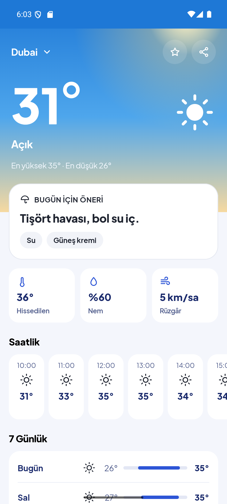
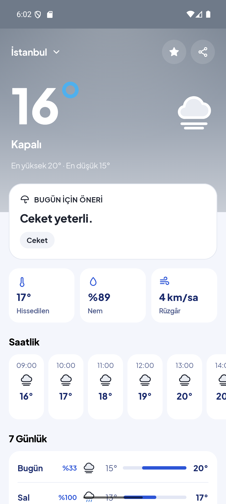
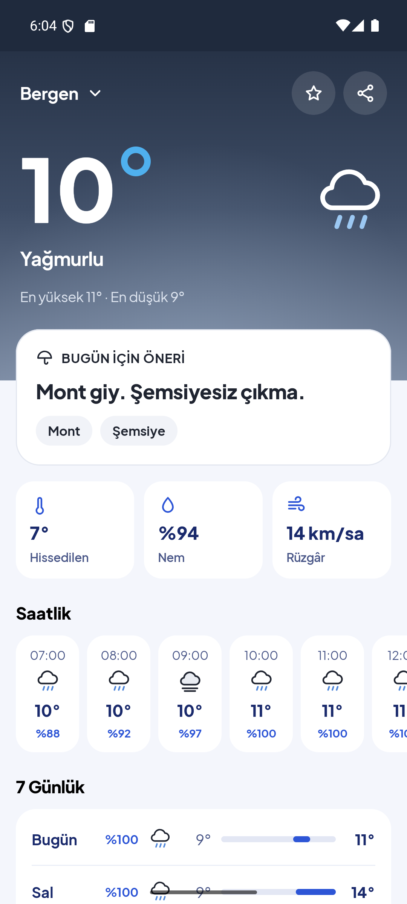
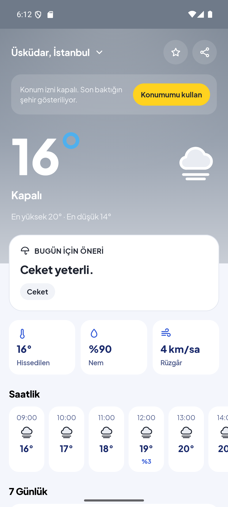
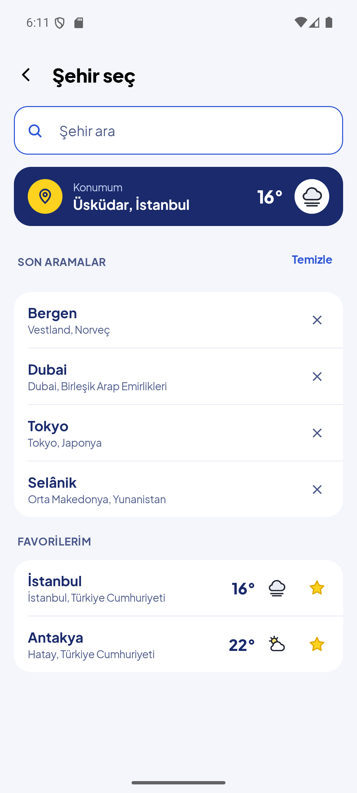
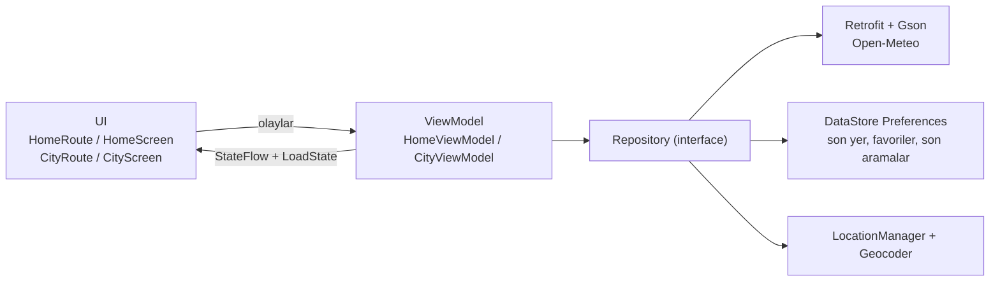

# Hava+

**Dereceden fazlası.**

Hava+, havayı sayı olarak değil karar olarak gösteren Türkçe bir Android hava durumu uygulamasıdır. Açtığında
"Ceket yeterli. 18:00'den sonra şemsiyeni al." gibi tek bir cümleyle ne giyeceğini ve şemsiye alıp almayacağını söyler;
3 saniyede bakıp kapatmak isteyen, her sabah "dışarısı nasıl, ne giysem?" diye soran herkes için tasarlandı.
Bilişim Kampı (KAMP+) Android eğitiminin `weather-app` projesinden doğdu.

## Ekran görüntüleri

<table>
  <tr>
    <td align="center"></td>
    <td align="center"></td>
    <td align="center"></td>
    <td align="center"></td>
    <td align="center"></td>
  </tr>
  <tr>
    <td align="center">Açık (Dubai)</td>
    <td align="center">Kapalı (İstanbul)</td>
    <td align="center">Yağmurlu (Bergen)</td>
    <td align="center">Konum izni yok</td>
    <td align="center">Şehir seç</td>
  </tr>
</table>

## Neden Hava+?

Hava+, "Turkcell bir hava durumu uygulaması geliştirmeye karar verseydi neyi amaçlardı?" sorusuyla başlayan bir tasarım egzersizidir.

**Problem:** Hava uygulamaları derece söyler, karar vermez. "16°, %33 yağış" bilgisini "ne giysem, şemsiye alayım mı?" cevabına
çevirmek kullanıcıya kalır.

**Çözüm:** Havayı günlük hayata bağlamak. Bu sorudan üç fikir çıktı:

1. **Havayı hayata bağla:** Ekranın merkezinde derece değil, öneri cümlesi var: "Mont giy. Şemsiyesiz çıkma."
2. **Ekosisteme bağla:** Tahmini paylaşım menüsünden BiP'te ya da başka bir uygulamada paylaş; havaya göre seçilmiş müziği fizy'de dinle.
3. **Türkiye'ye özgü, basit ve hızlı ol:** Tamamen Türkçe arayüz ("18:00'den / 19:00'dan" gibi ekler bile saate göre doğru),
   bulunduğun ilçenin adı, her şey tek kaydırmalık bir ana ekranda, kayıt veya API anahtarı yok.

## Özellikler

- **Öneri motoru:** Hissedilen sıcaklığa ve önümüzdeki 12 saatin yağış olasılığına bakıp bir giysi + şemsiye cümlesi ve en fazla 3 etiket ("Mont", "Şemsiye 18:00+") üretir. Saf Kotlin'dir, her kuralı unit testlidir (kurallar aşağıda).
- **Havaya göre değişen gökyüzü:** Ana ekranın üst alanı altı hava grubuna göre (açık, parçalı, kapalı/sis, yağmur, kar, fırtına) geçişli bir gökyüzü olarak çizilir; yazı, ikon ve durum çubuğu renkleri de gökyüzüne uyar.
- **Konum ve yedek akışı:** Yaklaşık konum izniyle bulunduğun ilçe gösterilir ("Üsküdar, İstanbul"). İzin yoksa son baktığın şehir, o da yoksa İstanbul açılır.
- **Favoriler ve son aramalar:** ☆ ile en fazla 10 favori; Şehir seç ekranında anlık sıcaklıklarıyla listelenir. Son 5 arama da saklanır. İkisi de uygulama kapansa da durur.
- **Saatlik ve 7 günlük tahmin:** Saatlik kartlarda yağış olasılığı; 7 günlük listede günün sıcaklık aralığı, haftanın aralığına göre konumlanan bir çubukla gösterilir.
- **Paylaşım:** "Hava+ · İstanbul bugün 16°, kapalı. Ceket yeterli." metni Android paylaşım menüsüyle gönderilir; BiP yüklüyse listede çıkar.
- **Havaya göre müzik önerisi:** Her hava grubu için bir tür (güneşli → Pop, yağmurlu → Sakin, fırtına → Rock…) ve "fizy'de dinle" kartı. Çalma listesi linkleri henüz seçilmedi; şimdilik hepsi `https://fizy.com` ana sayfasını açıyor (`model/FizyPlaylists.kt`).
- **Açılış ekranı:** Android 12+ SplashScreen API'siyle mavi zemin üzerinde "+°" logosu; ilk tahmin gelene kadar, en fazla 2 saniye ekranda kalır (yapay bekletme yok).

### Öneri motoru kuralları (`model/Advice.kt`)

| Konu | Koşul | Cümle | Etiket |
|---|---|---|---|
| Giysi | Hissedilen ≤ 5° | Mont, atkı ve bere zamanı. | Mont |
| | 6–12° | Mont giy. | Mont |
| | 13–18° | Ceket yeterli. | Ceket |
| | 19–24° | İnce bir üst yeterli. | İnce üst |
| | ≥ 25° | Tişört havası, bol su iç. | Su |
| Yağış | Şu an yağıyor ya da bu saatin olasılığı ≥ %50 | Şemsiyesiz çıkma. | Şemsiye |
| | İleriki bir saatte olasılık ≥ %50 | 18:00'den sonra şemsiyeni al. | Şemsiye 18:00+ |
| | 12 saatte en yüksek olasılık ≥ %30 | Yanına şemsiye almakta fayda var. | Şemsiye |
| Ek (en fazla biri, bu sırayla) | 12 saatte fırtına | Fırtına bekleniyor, dışarıda uzun kalma. | — |
| | 12 saatte kar | Yollar kaygan olabilir. | Bot |
| | Rüzgâr ≥ 40 km/sa | — | Rüzgârlık |
| | Hissedilen ≥ 30° | — | Güneş kremi |

"Şimdi", telefonun saati değil şehrin yerel saatidir; Tokyo'ya bakarken öneri Tokyo saatine göre hesaplanır.

## Tasarım kararları

- **"+°" logosu:** Büyük sarı bir artı ve sağ üstünde bir derece halkası. "°" derecedir. "+" iki yerden gelir:
  1) uygulama Bilişim Kampı KAMP+'ta doğdu, "+" bu kökene bir selam;
  2) slogan "Dereceden fazlası": uygulama yalnızca derece göstermez, öneri, paylaşım ve müzikle havayı günlük hayata bağlar.
- **Marka renkleri:** Canlı sarı (`#FFD21F`) yalnızca vurgu için: logodaki artı ve "Konumumu kullan" gibi birincil butonlar.
  Mavi (`#4FB0EE`) ana marka rengi; ikon ve açılış ekranının zemini, büyük sıcaklıktaki derece işareti de "°" karakteri
  yerine çizilmiş bir halka. Halka açık ve parçalı bulutlu gökyüzünde beyaz, diğerlerinde mavi.
- **Öneri kartı neden hep beyaz:** Uygulamanın asıl söylediği şey o cümle. Gökyüzü havaya göre değişirken kart sabit kalır;
  böylece her havada aynı yerde, aynı kontrastla okunur ve gözün ilk durduğu yer olur.
- **İkonlar neden `Image` ile:** Hava ikonları çok renkli vector drawable'lardır (ör. parçalı bulutta sarı güneş, yağmurda mavi damlalar, fırtınada sarı şimşek).
  `Icon` bileşeni bir ikonu tek renge boyar; bu yüzden `Image(painterResource(...))` ile, tint verilmeden gösterilirler.
  Üst alan (beyaz çizgili) ve beyaz kartlar için ayrı ikon setleri vardır.
- **İzin reddedilince:** Uygulama kilitlenmez ve tekrar tekrar sormaz. Son bakılan şehri (yoksa İstanbul'u) açar, üstte
  "Konum izni kapalı. Son baktığın şehir gösteriliyor." bandı ve "Konumumu kullan" butonu çıkar. İzin yalnızca yaklaşık
  konum (`ACCESS_COARSE_LOCATION`) içindir; ilçe adı için bu yeterli.

## Mimari

Kampta kurulan katmanlı yapı aynen korundu:

```
UI (Route + Screen)  →  ViewModel (StateFlow)  →  Repository (interface + gerçek uygulama)  →  Retrofit / DataStore / Android servisleri
```



Ekran durumu `sealed interface LoadState` ile dört hâlden biridir: yükleniyor, başarılı, boş, hata. Ağ ve disk işleri
Repository içinde `withContext(Dispatchers.IO)` ile yapılır. Her Repository bir interface olduğu için testlerde sahtesi kullanılır.

Kaynak kod: `app/src/main/java/com/kampplus/hava/`

| Klasör | İçerik |
|---|---|
| `model/` | `City`, `Forecast`, `WeatherCondition`, `Coordinates`, öneri motoru (`Advice.kt`), fizy linkleri (`FizyPlaylists.kt`) |
| `data/` | Open-Meteo API'leri (`ForecastApi`, `CityApi`, `ApiClient`), `WeatherRepository`, `CityRepository`, `LocationRepository`, `LastPlaceRepository`, `FavoritesRepository`, `RecentSearchRepository`, DataStore (`HavaDataStore`), `AppContainer` |
| `ui/` | Gezinme (`HavaNavHost`), `LoadState`, ortak biçimlendirme (`Format.kt`) |
| `ui/home/` | Ana ekran: `HomeRoute` / `HomeScreen`, `HomeViewModel`, bölümler, fizy kartı, gökyüzü seçimi (`WeatherStyle.kt`), paylaş/fizy Intent'leri |
| `ui/city/` | Şehir seç: `CityRoute` / `CityScreen`, `CityViewModel`, satırlar |
| `ui/component/` | Derece halkası, hava ikonu eşlemesi, çizgi ikonlar, hata/boş/yükleniyor görünümleri, durum çubuğu |
| `ui/theme/` | Marka renkleri, gökyüzü stilleri (`WeatherSky.kt`), Plus Jakarta Sans, tema |

Ayrıntılı tasarım ve iş planı: [`docs/HAVAPLUS_TASARIM.md`](docs/HAVAPLUS_TASARIM.md) ·
Her adımda ne değişti ve nasıl anlatılır: [`docs/OGRENME_NOTLARI.md`](docs/OGRENME_NOTLARI.md)

## Teknolojiler

- **Kotlin** ve **Jetpack Compose** (Material 3); XML layout ya da Fragment yok
- **ViewModel + StateFlow**, `viewModelScope` ile coroutine'ler
- **Navigation Compose** (rota parametreleri, `SavedStateHandle`)
- **Retrofit + Gson** ile **Open-Meteo** API'si (tahmin ve şehir arama)
- **DataStore Preferences** (son bakılan yer, favoriler, son aramalar)
- **core-splashscreen** (açılış ekranı)
- Konum için Android'in kendi `LocationManager` ve `Geocoder` sınıfları

Kampta kullanılanların dışına çıkılmadı: Hava+ için yalnızca iki Jetpack kütüphanesi (`datastore-preferences`,
`core-splashscreen`) eklendi. Hilt/Koin, Room, RxJava ya da Google Play Services yok.

## Test

**114 unit test**, 11 dosyada (`app/src/test/java/com/kampplus/hava/`):

| Ne test ediliyor | Dosyalar |
|---|---|
| Öneri motoru: her giysi aralığı, yağış kuralları, ek kurallar, Türkçe saat ekleri | `AdviceTest` |
| Ana ekran: yer seçme sırası (konum → son yer → İstanbul), izin akışı, favori yıldızı, hata durumları | `HomeViewModelTest` |
| Şehir seç: arama ve dört durum, favoriler, son aramalar, Konumum kartı | `CityViewModelTest` |
| Gökyüzü stili, konum bandı renkleri, aralık çubuğu, hava kodu → ikon eşlemesi | `WeatherStyleTest`, `WeatherIconsTest`, `WeatherConditionTest` |
| API yanıtlarının çözümlenmesi (sahte sunucu: MockWebServer) | `ForecastApiTest`, `CityApiTest` |
| DataStore'da saklama: favoriler (en fazla 10), son aramalar (en fazla 5), son yer | `FavoritesRepositoryTest`, `RecentSearchRepositoryTest`, `LastPlaceRepositoryTest` |

ViewModel testleri gerçek ağa ya da telefona dokunmaz: `FakeRepositories.kt` içindeki sahte Repository'ler ve
`MainDispatcherRule` kullanılır.

```bash
./gradlew testDebugUnitTest
```

## Çalıştırma

1. **Android Studio** Narwhal 3 Feature Drop (2025.1.3) ya da daha yenisi (proje AGP 8.13 ve JDK 17 kullanır).
2. Projeyi açın, Gradle senkronizasyonunu bekleyin, bir emülatör ya da Android 8.0+ (API 26+) telefonda **Run**.
   Komut satırından: `./gradlew assembleDebug`
3. **API anahtarı gerekmez.** Open-Meteo ücretsiz ve kayıtsızdır; yalnızca internet bağlantısı yeter.
4. **Emülatörde konum:** Emülatörün yanındaki **⋯ (Extended controls) → Location** bölümünde haritadan bir nokta seçip
   **Set Location**'a basın (ya da terminalde `adb emu geo fix 29.0151 41.0256`: önce boylam, sonra enlem).
   Uygulama açılışta yaklaşık konum izni ister; reddederseniz son bakılan şehir gösterilir.

Kod biçimi: `./gradlew spotlessApply` (ktlint).

## Kamptan Hava+'ya

Hava+, Bilişim Kampı (KAMP+) Android eğitiminin `weather-app` projesinin devamıdır. Kampta her ders bloğunun sonunda
projenin bir hâli vardı; Hava+ bunların üzerine, mimariyi değiştirmeden kuruldu.

| Kampta | Öğrenilenler |
|---|---|
| Uygulama 2: Sabit şehir listesi | Jetpack Compose ile ilk ekran, `CityCard`, `LazyColumn`, `data class` |
| Uygulama 3: Arama, state, ViewModel | Arama kutusu, `rememberSaveable`, listeyi filtreleme, state hoisting, `CityViewModel` ile `ViewModel` + `MutableStateFlow` / `StateFlow` |
| Uygulama 4: API ve dört durum | Retrofit + Gson ile Open-Meteo, `ApiClient`, Repository interface + gerçek uygulama, `sealed interface LoadState`, `viewModelScope.launch`, `withContext(Dispatchers.IO)` |
| Uygulama 5: Tahmin ekranı ve cila | Tahmin ekranı, Navigation Compose rotaları (`?name=&lat=`, `Uri.encode`), `SavedStateHandle`, `FakeRepository` + `MainDispatcherRule` ile unit testler |

| Hava+ için eklenen | Nasıl |
|---|---|
| Yeni görsel kimlik | "+°" logosu, marka renkleri, Plus Jakarta Sans, havaya göre gökyüzü (`Brush` geçişleri + `drawWithCache`) |
| Öneri motoru | Saf Kotlin kuralları (`data class` + `when`), 20 unit test |
| Konum | `ACCESS_COARSE_LOCATION` izni, `LocationManager` + `Geocoder`, izin yoksa yedek akışı |
| Kalıcı veri | DataStore Preferences; listeler Gson ile JSON olarak saklanır |
| Favoriler ve son aramalar | Yeni Repository'ler, ana ekran ve Şehir seç aynı akışı dinler |
| Paylaşım ve müzik | `Intent.ACTION_SEND` + paylaşım menüsü, `Intent.ACTION_VIEW` ile fizy linki |
| Açılış ekranı | `core-splashscreen`, ilk tahmin gelene kadar (en fazla 2 sn) |

## Notlar ve lisanslar

- Hava ve şehir verisi: [Open-Meteo](https://open-meteo.com) ([CC BY 4.0](https://creativecommons.org/licenses/by/4.0/)).
- Yazı tipi: [Plus Jakarta Sans](https://github.com/google/fonts/tree/main/ofl/plusjakartasans), SIL Open Font License 1.1 —
  [`docs/PlusJakartaSans-OFL.txt`](docs/PlusJakartaSans-OFL.txt).

Bu bir öğrenci projesidir; Turkcell, fizy veya BiP'in resmi ürünü değildir ve bu markalarla bağlantılı değildir. Marka logoları kullanılmamıştır.
